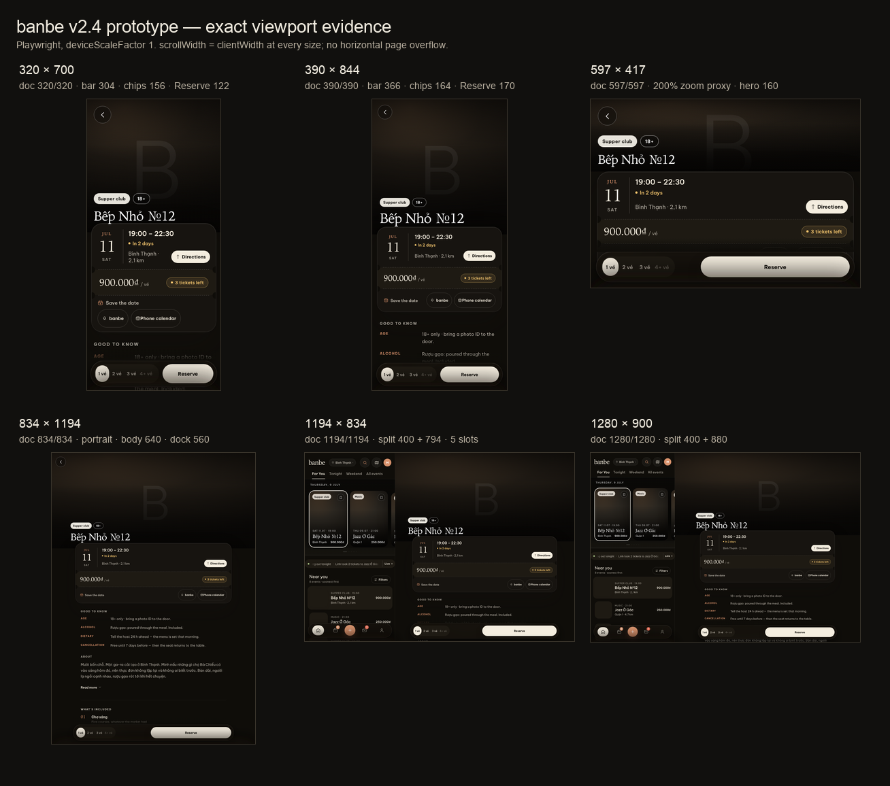
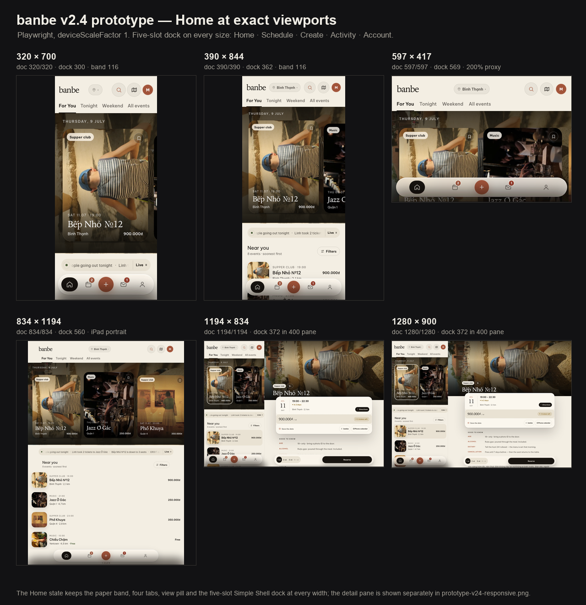

# v2.4 Home & Event Detail — web and iPad application

Status: **prototype updated, research + PR ready for review.** No production screen is rewritten by this PR; the
prototype is the design source, and this note is the contract for porting it. iOS native is deliberately out of scope.

Vietnamese summary: prototype `docs/prototypes/homescreen-event-detail-motion-v2-4.html` đã được kéo về sát bản web
đang chạy (band giấy 58 + 44 pt của note 94/95, tab For You / Tonight / Weekend / All events, dock Simple Shell 5 slot,
stub vé của note 77, Event Detail v8), đồng thời sửa các lỗi hiển thị ở 320 pt, bỏ chặn pinch zoom, và thêm layout
hai cột cho iPad nằm ngang. PR này cố ý chỉ gồm prototype + tài liệu này; bản sửa lớp "xoay điện thoại" cho iPad
được ghi ở §4 như việc tiếp theo của app, không đưa vào PR để giữ đúng phạm vi. Việc port vào Home/Event Detail thật
là bước tiếp theo, chia nhỏ theo kế hoạch bên dưới.

---

## 1. What was compared

The prototype was checked against the screens the web app actually ships today:

| Area | Source of truth | What the prototype now does |
| --- | --- | --- |
| Home band | `.claude/notes/94-home-band-and-web-top-bands.md`, `95-home-band-folds-on-scroll.md`; `src/components/home/HomeShellV5.jsx` | One static paper app bar: 58 pt row (wordmark, area chip in the middle, 40 pt search / Map / account circles) plus a 44 pt tabs row. Folds to 72 pt past 72 px of scroll, hysteresis at 24 px; the middle cross-fades from the area chip to a two-line view + area pill that opens a menu of For You / Tonight / Weekend / All events, Hosting, and the area picker. |
| Home content | `HomeShellV5.jsx`, notes 81/94/95/100 | Date kicker, featured rail with save control, Pulse ticker, "Near you" list and a Filters entry, type grid, pager. |
| Dock | `src/components/BottomTabBar.jsx`, `src/lib/dockLayout.js`, note 67 | 64 pt glass pill, five slots, icon-only, centre clay "+", clay/alert badges, no labels (aria only). |
| Event Detail | `EventDetailV23View.jsx`, `TicketStubV23.jsx`, notes 77/78/81 | Full-bleed hero, category + minimum-age pills, serif title, v2.3 ticket stub with the two calendar tiles (banbe Schedule / phone calendar), compact reserve bar that grows into the full card, "Good to know", section tabs with reading progress. |
| Reserve bar | `src/components/event/ReserveBarV23.jsx`, `src/lib/reserveBarV23.js`, note 81 | Opens compact with 1 · 2 · 3 · 4+ and a **plain Reserve button** so the stub is readable; the exact total appears once the bar grows into the full card (chips, total, per-ticket line, host's 1-hour trust line). Back at the top it compacts again. |
| Detail at 320 pt | note 90, modern-web pass | No horizontal overflow; the 4+ slot steps aside, the other three chips and the Reserve label stay whole. |

Still intentionally different from production: the prototype uses sample events, English demo copy, a text wordmark
instead of `/banbe-wordmark.png`, and has no auth, real booking, payment, QR, Project Hub or account screens. It is a
motion/layout reference, not a second implementation of the app.

---

## 2. The responsive contract

The whole contract is CSS-first. A device width must never be inferred from a user agent, and no screen may depend on a
fixed device size.

### 2.1 Breakpoints

| Range | Layout | Notes |
| --- | --- | --- |
| `0–359 px` | One column, edge to edge | 12–16 px gutters, area label folds to pin + chevron, hero title 32 px, stub margin 10 px, compact bar keeps 1 · 2 · 3 · 4+ and a plain Reserve. |
| `360–599 px` | One column, edge to edge | Standard phone. Full band + tabs; compact bar at 12 px side insets. |
| `600–899 px` | One column, held to a reading width | iPad portrait, small tablets, split-screen windows. Feed/band max 720 px, detail prose/stub max 640 px, dock max 560 px and centred; hero stays full-bleed. No split. |
| `≥ 760 px`, height ≥ 560 px, width > 0.9 × height | Two panes | List 44 % of the width below 1100 px, 400 px at 1100 px and wider; detail takes the rest. This is iPad landscape, Duo inner screen, and a desktop window. |
| `≥ 900 px`, portrait | One column | Do not split just because the window is wide; portrait tablets keep one eye-path. |

The split condition is **not width alone**. A phone on its side is 844 × 390: wide but too short, and it must stay one
column. The rule is min-width 760 px, min-height 560 px and a landscape-ish aspect (width > 0.9 × height). The
prototype uses `w >= 760 && h >= 560 && w > h * 0.9`; the web expresses the same rule as:

```css
@media (min-width: 760px) and (min-height: 560px) and (min-aspect-ratio: 9/10) { /* split */ }
```

`min-aspect-ratio` is supported well below the project's Safari 16.2 floor, so no JS listener is required. If the team
prefers one source of truth in JS, use one `matchMedia` and one `data` attribute; do not duplicate the query in three
components.

### 2.2 Split layout

- The left pane owns the list, its band, its scroll position and the dock. The dock is **inside** the left pane, not
  stretched across both. This is the mistake to avoid: a fixed dock at the viewport bottom on a 1180 px iPad would run
  under the detail pane.
- The right pane owns its own scroll, nav, progress line and sticky reserve bar. The bar is capped at 660 px and centred
  in the pane; the reading column is 640 px.
- The right pane is never empty: the selected event is shown, another row swaps it in place, and there is no Back on
  that side because nothing was pushed. On a cold deep link, the list opens with that event selected.
- A 1 px divider (or the fold shading on Duo) marks the seam. The selected row is marked in the list (`aria-current`,
  plus the ink/60 highlight). Do not rely on colour alone.
- The detail's close/back control is hidden in split; Escape and browser Back still work (Back changes the URL and
  returns to the list, not out of the app).

### 2.3 Type, touch and zoom

These are already true in the prototype and must survive the port:

- The viewport allows pinch zoom (`index.html` has no `maximum-scale`; do not add it back). Pinch magnifies; it must not
  reflow the layout into a narrower phone state.
- Every interactive target is at least 44 × 44 CSS px, including icon-only search/Map/account, the stepper, the chip
  row, the dock and the sheet close.
- No fixed-height label may clip its words. Use `min-height`, `padding-block`, wrapping, and let the row grow. The
  prototype's `overflow-wrap: anywhere` on card/detail titles and its 320 px rules are the floor.
- Body copy is capped at 640–720 px; at 820 pt portrait the eye path is one column, not 820 px of text.
- Meta text is not below 62 % ink on paper; the smallest labels must clear 4.5:1. The prototype's `--fg3` change is
  the same audit rule as the web's `--bb-text-meta` / `--bb-fg-3`.
- `prefers-reduced-motion` removes travel/scale and keeps progress information; `prefers-reduced-transparency` turns
  glass into the opaque surface. Both are already first-class in the app, and the prototype mirrors them.
- Nothing important may be hover-only. Search, save, view menu, area and reserve all have press/focus equivalents.

### 2.4 Measured floor (this pass)

Checked in Playwright at exact viewports, with screenshots at each size:

| Check | Result |
| --- | --- |
| Document width | 320/320, 390/390, 597/597, 834/834, 1194/1194 and 1280/1280 (`clientWidth`/`scrollWidth`) on Home and Detail |
| Compact bar at 320 | 304 px wide; four chips 156 px; plain Reserve 122 px; all four slots fit |
| Compact bar at 390 | 366 px wide; chips 164 px; Reserve 170 px; no overlap; plain label whole |
| Compact bar at 597 (200 % proxy) | 573 px wide; chips 164 px; Reserve capped at 330 px |
| Full bar at 390 | 170 px tall; price, 1·2·3·4+, Reserve and trust line all whole |
| Home band | 116 px expanded, 72 px folded; tabs row height 0 when folded; view pill names view + area |
| Dock | five slots at every size; inside the Home pane in split (ends at 386 of the 400 px pane) |
| iPad portrait 834 × 1194 | one column; body 640 px; dock 560 px; Title/hero full-bleed; no horizontal overflow |
| iPad landscape 1194 × 834 | Home 400 px + detail 794 px; cards 167/168/163 px, third peeks 19 px; detail bar 660 px; body 640 px |
| Web 1280 × 900 | Home 400 px + detail 880 px; same 640 px reading column; dock stays in the list pane |
| 200 % zoom proxy 597 × 417 | single column; band 116 px; hero flattened to 160 px; date/Directions/price and Reserve reachable without a horizontal scroll |

Each size was captured with Playwright at its real viewport, not by scaling a phone. A real iPad Safari pass is still
required before shipping; the 597 × 417 run is the CSS-viewport proxy for 200 % browser zoom.





---

## 3. Applying it to the web app

The production port should be a **layout pass**, not a rewrite. The v2.3 components are already the right content at
the right density; what changes is how they occupy a wide window.

### Phase 0 — one frame, one decision (small, no visual change)

1. Stop showing the 415 px desktop phone frame on touch-first tablets. The frame rule in `src/index.css` matches
   `(hover: hover) and (pointer: fine)`, which is normally false on iPad, but an iPad with a trackpad can report a fine
   primary pointer. Set one `html[data-input="mouse"]` attribute in `src/main.jsx` from
   `matchMedia('(pointer: fine)').matches && navigator.maxTouchPoints === 0`, and scope the frame to it. A touchscreen
   laptop then gets the full-bleed layout, which is the right result for a tablet-shaped screen.
2. Keep `--bb-strip-h` as the only status-strip height. The split must not introduce a second safe-area offset.
3. Make sure every full-height screen uses `100dvh` / the existing scroll viewport, never `100vh`.

### Phase 1 — the band and the list at tablet widths

- Move the band's width cap into a single rule: `.bb-home-head__bar` and `__tabs` max 720 px, centred; the hero stays
  full-bleed. This is already the shape of the prototype's `.device.roomy` rules.
- Cap the dock at 560 px in a roomy single column, centred. The prototype's `.device.roomy .dock` is the reference.
- Keep the 58 + 44 pt rows. At 320 pt the area label folds to its pin; the tab row must not clip. The current band
  already solves this; do not regress it while adding a max width.
- At the split breakpoint, reduce the rail card to ~170 px (two cards plus a third peeking in a 400 px pane) and keep
  the list rows compact. A 388 px poster card in a 400 px pane reads as one item, not a list.

### Phase 2 — the split detail

Suggested shape (names are illustrative, keep the existing component boundaries):

```jsx
// App shell
const wide = useMediaQuery('(min-width: 760px) and (min-height: 560px) and (min-aspect-ratio: 9/10)');
const detailKey = route.name === 'event' ? route.key : null;

<div className="bb-app-shell" data-wide={wide ? '1' : undefined}>
  <div className="bb-app-shell__list"> <HomeShellV5 ... /> </div>
  {wide && detailKey && (
    <div className="bb-app-shell__detail" role="region" aria-label={T('Chi tiết sự kiện', 'Event details')}>
      <EventDetailV23View key={detailKey} ... />
    </div>
  )}
</div>
```

- `.bb-app-shell[data-wide]` is `display:grid; grid-template-columns: 44% minmax(0, 1fr);`, and `400px minmax(0, 1fr)` from 1100 px wide (the prototype's list rule)
  and the detail wrapper is `position:relative; min-width:0; overflow:hidden`.
- The existing detail view positions itself `fixed`/`absolute` against the phone viewport. Add a `presentation="pane"`
  (or a `data-split` wrapper) that changes it to `position:relative`, `inset:auto`, `height:100%`. Do not fork the
  whole component; only the shell/positioning and the close control change.
- Route stays `/event/:key`. Opening a row uses the existing `useUrlSync` push; selecting another replaces (or pushes)
  the same route. Browser Back from a deep link returns to the list. The list keeps its scroll position; the right pane
  scrolls to the top on a new key.
- Hide the detail's Back/close control in the pane; keep Escape and `popstate`. Focus moves to the detail heading when
  the key changes, not on every render. The selected row gets `aria-current="true"`.
- The split is a **presentation** of the same page, not a second page. One `EventDetailV23View`, one source of booking
  state. Do not render a hidden phone detail as well.

### Phase 3 — the reserve bar and zoom

- The compact bar is deliberately a **plain Reserve**; the total lives once, in the full card. Do not put a price in
  the compact CTA to fill the space. All four slots stay at 320 pt: the plain label leaves room, so nothing needs to
  be hidden or clipped when the bar moves to `EventDetailV23View`.
- The full bar is the one place that computes and shows `price × qty`. The compact and full states must not have two
  totals that can disagree.
- Test at 200 % browser zoom on a 1180 px iPad: the effective CSS width is ~590 px, so the app must fall back to the
  single-column layout, not squeeze the split. Because the breakpoint is in CSS px, this works automatically; this is
  why the split must never be a hard-coded two-column grid at all widths.
- At 200 % the band's tab row can overflow; use a horizontal scroller with snap and an edge fade, not a clipped row.
  The same applies to the detail's section tabs.

### Phase 4 — iPad Safari details

- **Viewport:** `viewport-fit=cover` is already set. Respect `env(safe-area-inset-top/bottom)`; the fixed strip and the
  scroll viewport already share `--bb-strip-h`. The detail pane's sticky bar needs the bottom inset, not a hard 16 px.
- **Toolbar:** iPad Safari's toolbar collapses while scrolling; `dvh` and the visual-viewport-aware viewport handle it.
  Do not listen to `window.innerHeight` alone for layout.
- **Rotation:** no rotation lock; the app reflows. In landscape the overlay must not appear. The app-side fix is in
  §4: scope `src/index.css`'s overlay to a phone-sized landscape window. Keep its message honest: it is a phone hint,
  not a lock.
- **Standalone:** the project deliberately has no PWA manifest (`index.html`), so there is no standalone iPad mode to
  design for; it runs in Safari (or a Home Screen bookmark using Safari's own frame). Do not add a manifest just for
  this layout.
- **Trackpad/keyboard:** visible focus rings, Tab order through band → tabs → list → detail, Escape closes a sheet
  before it closes the event. Hover is never the only way to reveal a control.
- **iOS native:** unchanged. The native app keeps its current navigation and split behaviour; this work is web-only.
  If the native iPad split is wanted later, it is a separate SwiftUI design task, not a port of this CSS.

---

## 4. App-side follow-up: the rotate overlay (not in this PR)

This PR stays prototype + docs. The web app needs this small fix in the same release as the iPad split:

`src/index.css` currently has:

```css
@media (orientation: landscape) and (pointer: coarse) { /* hide #root, show the rotate overlay */ }
```

That matches an iPad in landscape, so the web app disappears behind "Please rotate your phone" — the one orientation
where the split layout is useful. The rule should become:

```css
@media (orientation: landscape) and (pointer: coarse) and (max-height: 520px) and (max-width: 1000px) { ... }
```

An iPad in landscape is at least 1024 × 768; a phone on its side is 667–932 × 320–430. A short Split View window is
wider than a phone, so it is not mistaken for one. This is a real, user-visible bug; it belongs to the app-side port,
not to this design PR.

---

## 5. QA matrix

Run this on real hardware where possible. "Prototype" means the single HTML file; "app" means after the port.

| Device / state | Size (CSS px) | What to check |
| --- | --- | --- |
| iPhone SE (1st gen) | 320 × 568 | No horizontal scroll; band keeps one row; compact bar shows 1·2·3·4+ + Reserve, none clipped; title wraps; tap targets 44. |
| iPhone 13 mini | 375 × 812 | Same, with the 4+ slot visible and the Reserve label whole. |
| iPhone 14 / 15 | 390 × 844 | Full band 116 → folded 72; view menu; compact → full bar at 40 px; tabs readable. |
| iPhone Pro Max | 430 × 932 | Rail card proportion; no oversized gutters; detail title on one line. |
| Phone landscape | 844 × 390 | Rotate overlay (phone only); app hidden; message readable. |
| iPad portrait | 834 × 1194 | One column; body 640; dock ≤ 560; no 415 px desktop frame. |
| iPad landscape | 1194 × 834 | Split 400 + 794; two cards + third peek; no dock under the detail; detail bar 660; divider; selected row. |
| iPad Split View / Stage Manager | e.g. 600 × 900, 900 × 700 | 600: one column, reading width. 900 × 700 landscape: split if height ≥ 560; no clipped band. |
| Desktop Safari/Chrome | 1440 × 900 | 415 px frame only for a real mouse; no frame on a touchscreen laptop; zoom 200 % stays usable. |
| Browser zoom 200 % | 1194 × 834 → 597 × 417 CSS | Single column; no clipped tabs; plain Reserve whole; date/price readable in the full bar; page scrolls to the ticket. |
| Text size / accessibility | iOS Larger Text, browser 200 % | No fixed-height clipping; all text wraps; the amount (price/total) stays visible. |
| Light / Dark / System | all | Paper and ink switch; glass has an opaque fallback; contrast ≥ 4.5:1 for labels. |
| Reduce Motion | all | No parallax/stagger/slide; progress and state changes still visible. |
| Reduce Transparency | all | Dock/bar/nav become opaque; text contrast unchanged. |
| Keyboard only | desktop/iPad keyboard | Focus visible; tab order; Escape closes a sheet; Back returns to the list in split. |

Acceptance criteria for the port:

1. At every width from 320 to 1440, `document.documentElement.scrollWidth === innerWidth` on Home and Event Detail.
2. The band never clips a tab or the area label; at 320 it folds the label, not the controls.
3. The compact bar always shows the quantity and an unclipped Reserve control; none of the chips or the label is
   clipped at 320/360/375/390, and the exact total is readable in the full bar.
4. iPad landscape shows the list and the detail together; the dock stays in the list pane; the detail pane has its own
   scroll and bar.
5. iPad portrait is one column and does not show the phone frame or the rotate overlay.
6. Browser zoom to 200 % and iOS Larger Text do not hide a primary action or clip its label.
7. Pinch zoom works and does not reflow the app into a different layout.
8. Selecting a split row swaps the right pane without replaying the list; Back returns to the list and keeps its
   scroll; a deep link opens the same event selected.
9. Reduced Motion/Transparency and both themes keep every control legible.
10. `npm run build` and the existing unit suite are green; the new behaviour has at least one Playwright case for the
    split (or a DOM-level test if Chromium is unavailable on the build machine).

---

## 6. What is in this PR, and how to look at it

Files:

- `docs/prototypes/homescreen-event-detail-motion-v2-4.html` — the updated prototype (band, tabs, view menu, dock,
  stub, compact/full bar, 320 rules, split, zoom).
- `docs/impl/prototype-v24-web-ipad.md` — this note.
- `docs/impl/evidence/prototype-v24-responsive.png` — the six detail screenshots and their measurements.
- `docs/impl/evidence/prototype-v24-home-responsive.png` — the same six viewports in the Home state, with the five-slot dock.
- No app source files. The rotate-overlay fix in §4 is recorded for the app-side port, not included here, so the diff
  stays exactly prototype + documentation.

To view the prototype, no build is needed:

```bash
open docs/prototypes/homescreen-event-detail-motion-v2-4.html
# or, to serve it with the real photos:
python3 -m http.server 8000
# http://localhost:8000/docs/prototypes/homescreen-event-detail-motion-v2-4.html
```

It opens in Fill mode, so the browser window (or the iPad) **is** the device. Resize the window across 320, 390, 597
(200 % proxy), 834 (iPad portrait), 1194 (iPad landscape) and 1280 (wide web); rotate the iPad; use Safari's zoom. Opening the file directly without the server leaves the sample photos
blank (the file looks for `/photos/...` and `../../public/photos/...`); the layout, band, stub and bar are unaffected.

Checks run for this PR:

- `node --check` on the prototype's extracted script: pass.
- HTML structure parse: no unclosed or mismatched elements.
- `npm run build`: pass (the two pre-existing esbuild warnings in `Reserve.jsx` and `Rewards.jsx` are unrelated and were
  present before this change).
- Layout measurements and screenshots at 320, 390, 597 (200 % proxy), 834 (iPad portrait), 1194 (iPad landscape) and
  1280 (wide web) as listed in §2.4, all at their real viewport. A real iPad Safari check remains the reviewer's step.

Not in this PR: the app-wide Home/Event Detail rewrite, the iPad native split, any migration, any new dependency, and
any change to booking/payment logic.

---

## 7. Open decisions for the owner

1. **Split default:** show the first event on a cold `/home` at iPad landscape, or show a calm "Choose an event" pane?
   The prototype opens the first event and marks it, so the right side is never empty. An empty state is cheaper to
   port but makes the feature undiscoverable.
2. **Left pane controls:** keep search, Map and account in the 400 px band, or move search into the list and leave the
   band to the wordmark + area? The prototype keeps all three; at 400 px they fit, but the band is dense.
3. **Dock cap:** 560 px is the prototype's reading-friendly cap. If the dock should feel like an iPadOS dock, it could
   be narrower (420–480) and sit closer to the bottom edge.
4. **All events tab:** keep it as the fourth tab (shipped today) or fold it into the view menu? The prototype keeps it
   visible, which is honest for a guest whose For You is the whole catalogue.
5. **Desktop frame:** keep the 415 px phone frame for mouse users (current behaviour), or let a desktop window use the
   split too? The split at ≥760 px already supports a desktop; the frame is a presentation choice, not a layout one.
